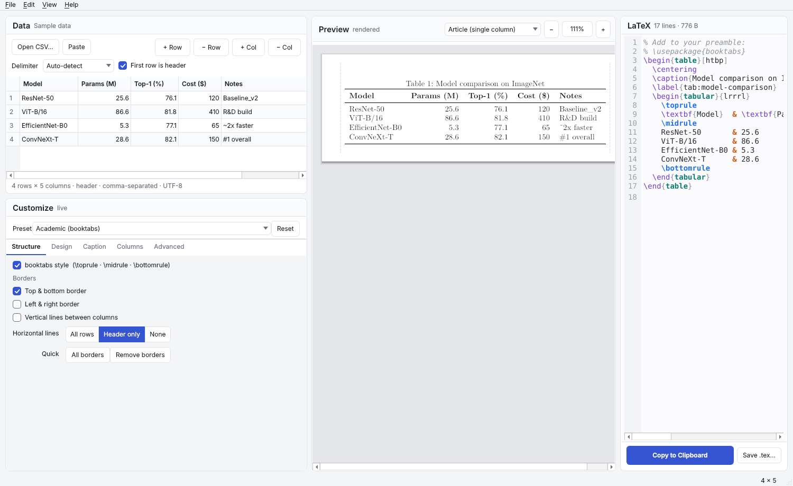

# LaTeX Table Generator

A cross-platform desktop app (Windows · macOS · Linux) that turns a CSV file into
LaTeX table code, with **three live-synced panes**: an editable data table, a
rendered preview that looks like the compiled LaTeX, and syntax-highlighted code
you can copy in one click. There's no Generate button: every edit updates the
preview and the code straight away.



You don't need a LaTeX installation. The preview is drawn with Qt using LaTeX's
own measurements and the bundled Latin Modern font, so it works as soon as the
app starts.

---

## Quick start

```bash
cd latex_table_gen
python -m venv .venv
# Windows: .venv\Scripts\activate      macOS/Linux: source .venv/bin/activate
pip install -r requirements.txt
python main.py                 # or: python main.py path/to/data.csv
```

Conda users can run `conda install -c conda-forge pyside6 pandas` instead of the `pip install` step.

You need Python 3.10 or newer. The app has been tested with Python 3.10 (PySide6 6.5, pandas 1.5) and Python 3.13 (PySide6 6.11, pandas 3.0).

---

## Double-click app (no terminal)

Run the build script for your OS **once**; it creates its own virtual environment, installs
everything and builds the app into `dist/`:

| OS | Double-click | Result |
|---|---|---|
| macOS | `build_macos.command` | `dist/LaTeX Table Generator.app` (drag to Applications) |
| Windows | `build_windows.bat` | `dist\LaTeXTableGen.exe` |
| Linux | `build_linux.sh` | `dist/LaTeXTableGen` |

On macOS the first launch of an unsigned app needs right-click → **Open**. If double-clicking
the `.command` file is blocked, run `chmod +x build_macos.command` once in a terminal.

---

## Features

### 1 · File input
* **Open CSV…**, **drag & drop** a file anywhere on the window, or **Paste** CSV or
  tab-separated cells copied from Excel, LibreOffice or Google Sheets.
* The delimiter is detected automatically (`,` `;` tab `|`). You can also force one, which re-parses the file.
* **First row is header** toggle. The app guesses on load, and toggling never loses any edits you've made.
* Every cell is read as text, so `001` stays `001`, `0.10` stays `0.10` and an empty cell stays empty.
* Encodings are tried in order: UTF-8 (with or without a BOM), then Windows-1252, then Latin-1.
* **Editable table view** (`QTableView`):
  * Double-click a cell to edit it, or a header to rename the column.
  * Right-click for insert/delete row and column, alignment, and include/exclude.
  * Ctrl+C / Ctrl+V copy and paste blocks of cells, and Del clears them.

### 2 · LaTeX generation
* Generates a `table` (or `table*`) float containing a `tabular`.
* Two styles: **classic** (`\hline`) or **booktabs** (`\toprule` · `\midrule` · `\bottomrule`).
* Auto-escapes `& % $ # _ { } ~ ^ \` in a single pass, so nothing gets double-escaped. It also escapes `< > |`, which print as the wrong glyphs under the default font encoding.
  Turn escaping off if your cells already contain LaTeX, such as `$x^2$`.
* Per-column alignment: `l`, `c`, `r` or `p{width}`. Widths can be `3cm`, `1.5in`, `40mm`, `80pt`, `0.3\linewidth`, and so on.
  Numeric columns default to `r`.
* Lists the `\usepackage` lines your table needs, or emits a full standalone document that compiles as-is.
* **Copy to Clipboard** with one click (Ctrl+Shift+C), or **Save .tex…** (Ctrl+S).

### 3 · Live customization panel
| Tab | Options |
|---|---|
| **Structure** | booktabs on/off · top & bottom border · left & right border · vertical lines between columns · horizontal lines: *all / header only / none* · one-click *All borders* / *Remove borders* |
| **Design** | font size (`\tiny` … `\Huge`) · table alignment *left / center / right* · set all column alignments · bold header · rotate (`\rotatebox{90}` or a landscape `sidewaystable`) · scale with `\resizebox{0.9\textwidth}{!}{…}` |
| **Caption** | caption text · position *top / bottom* · `\label{tab:…}` (with *From caption* auto-label) · `\centering` toggle |
| **Columns** | per-column include · `l c r p` · `p{width}` |
| **Advanced** | striped rows (`\rowcolors`, choice of colour and tint) · column spacing (`\tabcolsep`) · row spacing (`\arraystretch`) · `table` / `table*` / bare `tabular` · float placement `[htbp]`, `[H]`, … · output switches |

The **Preset** menu applies whole styles in one click: *Academic (booktabs)*, *Full grid*, *Boxed*, *Striped*, *Minimal* or *No borders*.

### 4 · Triple live preview
* **Left:** the editable data, with the customization panel below it.
* **Middle:** the rendered preview. It's drawn on a page using LaTeX's real metrics: `\tabcolsep`,
  `\arrayrulewidth`, booktabs rule widths and spacing, `\arraystretch`, caption
  skips, and `\textwidth` / `\columnwidth`. It shows borders, alignment, caption,
  stripes, rotation and scaling. Choose *Article*, *1-inch margins* or a *two-column* page to see how
  `table` and `table*` fit. When a table is wider than `\linewidth`, the overflow is
  highlighted and the app tells you by how many points.
  Zoom with the −/+ buttons or Ctrl+wheel; click the % button to fit the pane width again.
* **Right:** the LaTeX code, with syntax highlighting and line numbers.

### 5 · Graceful error handling
| Situation | Behaviour |
|---|---|
| Empty or whitespace-only file | Friendly message; your current table is kept |
| Binary file (e.g. an `.xlsx` renamed to `.csv`) | Detected; the message suggests exporting to CSV |
| Malformed or ragged rows | Short rows are padded with empty cells and a warning names how many rows were affected; unparseable lines are skipped with a warning |
| Huge file (> 10,000 rows) | You're warned; the preview shows the first 100 rows and the generated code contains **every** row. Code highlighting switches off above 4,000 lines so the app stays responsive. |
| More than about 45 rows | Note that a float can't break across pages, so consider `longtable` |

---

## LaTeX packages the output may need

| Feature | Package |
|---|---|
| booktabs rules | `\usepackage{booktabs}` |
| `\resizebox`, `\rotatebox` | `\usepackage{graphicx}` |
| landscape `sidewaystable` | `\usepackage{rotating}` |
| striped rows | `\usepackage[table]{xcolor}` |
| `[H]` placement | `\usepackage{float}` |

The code pane lists exactly the ones the current table uses.

---

## Packaging a standalone executable (PyInstaller)

Build **on each target OS**, since PyInstaller doesn't cross-compile. Run the build from a clean
virtual environment that contains only `requirements.txt` plus PyInstaller. This
keeps unrelated libraries such as SciPy or Matplotlib out of the bundle. A clean
Linux build is about 85 MB.

```bash
pip install pyinstaller
```

**Minimal command (as requested):**

```bash
pyinstaller --windowed --onefile main.py
```

This works, but it doesn't bundle the preview font, so the preview falls back to
a system serif font. To include the Latin Modern font (recommended), add the
`assets` folder:

**Windows / Linux** (creates a single file, `dist/LaTeXTableGen.exe` or `dist/LaTeXTableGen`)
```bash
pyinstaller --windowed --onefile --name LaTeXTableGen --add-data "assets:assets" main.py
```

**macOS** (creates `dist/LaTeXTableGen.app`)
```bash
pyinstaller --windowed --name LaTeXTableGen --add-data "assets:assets" main.py
```
On macOS, use the default one-folder mode. PyInstaller 6 deprecates `--onefile`
combined with `--windowed`, because an `.app` bundle can't be a single file.

Notes
* PyInstaller 6 or newer accepts the `:` separator in `--add-data` on every OS. Older versions on
  Windows need `"assets;assets"`.
* To add an icon, use `--icon app.ico` (Windows) or `--icon app.icns` (macOS). The window icon is
  drawn in code, so you don't need an icon file to run the app.
* Unsigned apps trigger a SmartScreen warning on Windows and Gatekeeper on macOS. On macOS,
  right-click the app and choose **Open** the first time.

---

## Project structure

```
latex_table_gen/
├── main.py                  # entry point: python main.py [file.csv]
├── core/
│   ├── csv_parser.py        # delimiter/header detection, encodings, error handling (pandas)
│   └── latex_generator.py   # escaping, tabular/booktabs, all options, package detection
├── ui/
│   ├── main_window.py       # 3-panel layout, loading, drag & drop, live sync (debounced)
│   ├── data_table.py        # editable QAbstractTableModel + QTableView
│   ├── controls_widget.py   # customization panel (Structure/Design/Caption/Columns/Advanced)
│   ├── preview_widget.py    # QPainter LaTeX-like renderer + highlighted code pane
│   └── style.py             # light/dark themes, fonts, style sheet
├── assets/fonts/            # Latin Modern Roman (GUST Font License)
├── tests/test_core.py       # python -m pytest -q
├── docs/screenshot.png
├── requirements.txt
└── README.md
```

`core/` has no Qt dependency, so you can use it from scripts:

```python
from core.csv_parser import parse_csv
from core.latex_generator import ColumnSpec, TableOptions, generate_latex

r = parse_csv("data.csv")
cols = [ColumnSpec("l")] + [ColumnSpec("r")] * (r.n_cols - 1)
print(generate_latex(r.header, r.rows, cols, TableOptions(caption="Results", label="res")).code)
```

### Design note: the preview renderer
The spec suggested Matplotlib's table or HTML in a `QTextBrowser`. The app instead draws
the preview directly with `QPainter`, for three reasons:
* `QTextBrowser`'s HTML subset can't rotate, scale to `\textwidth`, or draw booktabs rules
  with distinct widths and spacing.
* Matplotlib is a heavy extra dependency and is slow to redraw on every keystroke.
* The custom renderer uses LaTeX's own lengths, so its output matches `pdflatex` very closely.
  Line breaks in `p{}` columns are approximate because LaTeX also hyphenates.

---

## Keyboard shortcuts
| Action | Shortcut |
|---|---|
| Open CSV | Ctrl+O |
| Paste table from clipboard | Ctrl+Shift+V |
| Copy LaTeX | Ctrl+Shift+C |
| Save .tex | Ctrl+S |
| Add row / column | Ctrl+Shift+R / Ctrl+Shift+K |
| Zoom in / out / fit | Ctrl++ / Ctrl+− / Ctrl+0 (or Ctrl+wheel) |
| Dark theme | Ctrl+Shift+D |

(On macOS, use Cmd in place of Ctrl.)

## Limitations
* There's no `\multicolumn` / `\multirow`, `longtable` or `siunitx` decimal alignment yet.
* In raw-LaTeX mode (escaping off), the preview shows cell text as typed. Math and macros aren't typeset.
* The code pane is read-only. Make your edits in the data table or the controls, and the code regenerates.

## License notes
Latin Modern fonts © GUST e-foundry, distributed unmodified under the GUST Font License
(`assets/fonts/GUST-FONT-LICENSE.txt`).
